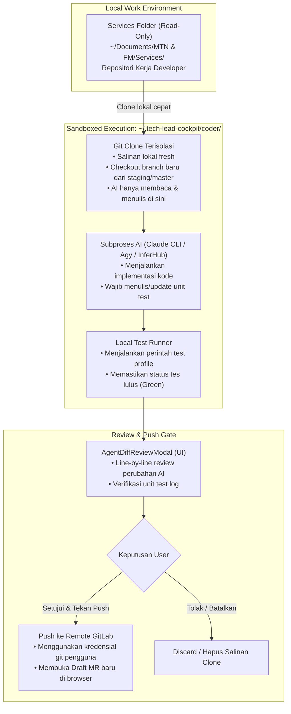

# Harness: Coder Agents & Local Task Runs

Modul ini mendokumentasikan fitur **Coder Agents & Agent Tasks**: eksekusi agen pengkodean otonom lokal yang mengimplementasikan task-task arsitektur dari TAD langsung ke repositori microservice secara terisolasi dan aman.

---

## 🎯 Ringkasan & Filosofi Keamanan (Guardrails)

Fitur Coder Agent dibangun dengan filosofi keamanan yang sangat ketat: **AI tidak pernah diberikan akses langsung untuk mengubah repositori kerja utama pengguna tanpa isolasi dan review manual.**



---

## 📂 Peta File Source Code (Coder Agents Module)

### Frontend (`src/coder/`, `src/views/`, `src/lib/coder/`)
| File Path | Komponen | Deskripsi & Tanggung Jawab |
|---|---|---|
| [`src/views/AgentTasksView.svelte`](file:///Users/ridwan/mine/tech-lead-cockpit/src/views/AgentTasksView.svelte) | Halaman Agent Tasks | Dashboard sentral seluruh run coding agent: status (`queued`, `running`, `completed`, `failed`), waktu eksekusi, tombol kontrol (Pause, Cancel, Review). Juga menampilkan review MR / cek TAD yang berjalan di background (kind `review`, lihat [MR Review](../mr-review/index.md#review-di-background-agent-tasks)) dengan hasil via [`ReviewTaskResult.svelte`](../../../src/views/ReviewTaskResult.svelte). |
| [`src/coder/AgentRunsPanel.svelte`](file:///Users/ridwan/mine/tech-lead-cockpit/src/coder/AgentRunsPanel.svelte) | Panel Antrean Agent | Menampilkan task-task yang sedang berjalan atau antre untuk dieksekusi secara paralel berdasarkan batas konkurensi. |
| [`src/coder/StartAgentsDialog.svelte`](file:///Users/ridwan/mine/tech-lead-cockpit/src/coder/StartAgentsDialog.svelte) | Dialog Peluncuran Agent | Modal untuk memilih task dari TAD, memetakan repositori target, memilih profil (Backend/Frontend), dan menentukan base branch. |
| [`src/coder/AgentDiffReviewModal.svelte`](file:///Users/ridwan/mine/tech-lead-cockpit/src/coder/AgentDiffReviewModal.svelte) | Modal Review Diff | Menampilkan perbandingan diff lengkap dari hasil kerja agent sebelum diizinkan push ke GitLab. |
| [`src/coder/TadFlowUnitTestModal.svelte`](file:///Users/ridwan/mine/tech-lead-cockpit/src/coder/TadFlowUnitTestModal.svelte) | Modal Verifikasi Test | Memeriksa apakah alur teknis (flow) yang dispesifikasikan pada TAD telah dipetakan menjadi unit test oleh agent. |
| [`src/components/AgentTaskLogViewer.svelte`](file:///Users/ridwan/mine/tech-lead-cockpit/src/components/AgentTaskLogViewer.svelte) | Streaming Log Viewer | Komponen visualizer log ANSI terminal real-time untuk memantau aktivitas proses agent. |
| [`src/lib/coder/client.ts`](file:///Users/ridwan/mine/tech-lead-cockpit/src/lib/coder/client.ts) | Coder Frontend Client | Penghubung API fetch ke rute `/api/connector/coder/*`. |
| [`src/lib/coder/types.ts`](file:///Users/ridwan/mine/tech-lead-cockpit/src/lib/coder/types.ts) | Definisi Tipe Coder | Interface untuk `CoderRun` (termasuk `quotaResetAt` dan `resumable`), `CoderProfile`, `CoderRunEvent`, `CoderSettings`, dan payload request. |
| [`src/lib/coder/cooldown.ts`](../../../src/lib/coder/cooldown.ts) | Cooldown Kuota | `quotaCooldownMs` (sisa waktu sampai kuota pulih) dan `formatWait` ("3 menit 8 detik"), dipakai connector (menolak revisi) dan UI (countdown di tombol Revisi/Lanjutkan Task). |

### Backend Connector (`connector/`)
| File Path | Komponen | Deskripsi & Tanggung Jawab |
|---|---|---|
| [`connector/coder-runs.ts`](file:///Users/ridwan/mine/tech-lead-cockpit/connector/coder-runs.ts) | Core Coder Engine | Mengatur siklus hidup run agent, kloning git terisolasi, eksekusi AI subprocess, pembatasan konkurensi (default 2 run simultan), pengujian otomatis, dan push git. |
| [`connector/agent-tasks.ts`](file:///Users/ridwan/mine/tech-lead-cockpit/connector/agent-tasks.ts) | Agent Task Store | Sinkronisasi dan persistensi state tugas agent lokal ke memori dan disk. |
| [`connector/coder-agent-sync.ts`](file:///Users/ridwan/mine/tech-lead-cockpit/connector/coder-agent-sync.ts) | Event Synchronizer | Menghubungkan event dari `coder-runs` ke antarmuka `agentRuntime`. |
| [`connector/openai-tool-runner.ts`](file:///Users/ridwan/mine/tech-lead-cockpit/connector/openai-tool-runner.ts) | OpenAI Function Tool Runner | Adapter pemanggilan tool eksekusi (read file, edit file, run test) untuk model berbasis OpenAI API. |

---

## 🛡️ Aturan & Profil Standar (Default Profiles)

Diatur dalam [`connector/coder-runs.ts`](file:///Users/ridwan/mine/tech-lead-cockpit/connector/coder-runs.ts):

### 1. Profil Backend (`backend`)
- **Fokus**: Route, handler, service, repository, format response, dan error handling standar.
- **Mandatori Unit Test**: Wajib menulis atau memperbarui unit test yang memetakan flow TAD (validasi payload, happy path, kondisi branching/reject, fallback error dengan mock).
- **Larangan Keras**: Dilarang membuat/mengubah file `.env`, credential, konfigurasi deployment, atau migrasi yang berpotensi menghapus data produksi.

### 2. Profil Frontend (`frontend`)
- **Fokus**: Komponen UI, reusable styling, validasi formulir, penanganan state, dan konsumsi API.
- **Mandatori Unit Test / Lint**: Wajib menjalankan lint dan test komponen untuk memastikan form validation teruji.
- **Larangan Keras**: Dilarang menambah dependency/library baru tanpa alasan mendesak, dilarang merombak konfigurasi bundler/build tool.

---

### 3. Provider yang boleh mengerjakan coding

Hanya **Claude CLI** dan **Antigravity CLI** (`CODER_PROVIDERS`, `canCode` di [`connector/coder-runs.ts`](../../../connector/coder-runs.ts)). InferHub dan 9Router memakai loop tool dokumen di [`connector/openai-tool-runner.ts`](../../../connector/openai-tool-runner.ts). Loop itu dibuat untuk generator TAD: system prompt-nya tentang TAD, `write_file` hanya boleh menulis Markdown, dan ada fallback yang menulis `TAD.md`. Jadi task coding di sana tidak bisa membuat file kode, dan bisa berakhir menulis `TAD.md` (kasus MU-2509). Karena itu provider API ditolak saat profil disimpan (`updateSettings`), saat run dimulai (`start`), dan saat run lama dilanjutkan/direvisi. Picker AI di profil hanya menawarkan Claude/Antigravity (`AiPicker` prop `only`). AI Review di modal diff tetap boleh memakai provider apa pun karena hanya membaca.

### 4. Tidak ada perubahan ≠ mengarang perubahan

Prompt awal dan setiap revisi memuat `NO_FAKE_CHANGES`: agent dilarang membuat file lain (dokumentasi, `TAD.md`, README, test kosong) hanya supaya ada diff. Bila spesifikasi sudah terpenuhi, agent menulis `SUDAH TERPENUHI:` beserta bukti file:baris. Run tanpa perubahan tetap gagal, tapi pesannya membedakan "agent menilai task sudah terpenuhi di branch base" dari "tidak mengubah apa pun", dan menyarankan tandai selesai atau revisi dengan instruksi yang spesifik. Checkout branch memakai `-B`, sehingga retry di folder kerja yang sama tidak gagal dengan "a branch named … already exists".

### 5. Tahan gangguan sementara (retry, resume, cooldown)

Diatur di [`connector/coder-runs.ts`](../../../connector/coder-runs.ts) (`transientFailure`, `quotaResetInMs`, `nextRetry`) dan diuji di [`connector/coder-runs.test.ts`](../../../connector/coder-runs.test.ts) (`transient provider errors`, `resilience`).

- **Klasifikasi error.** `transientFailure` hanya menganggap dua jenis error provider sebagai sementara: kuota/rate limit (`Individual quota reached … Resets in 3m8s`, `usage limit reached`, `RESOURCE_EXHAUSTED`, 429/529, overloaded) dan jaringan (`There was a network issue connecting to the server`, `Connection error`, `ECONNRESET`, `ETIMEDOUT`, 502/503/504). Perintah terminal yang diblokir, belum login, timeout 60 menit, request tidak valid, dan "context limit" tidak pernah di-retry. Validasi sebelum agent jalan (spesifikasi kosong, repo tidak valid) tetap langsung ditolak.
- **Kuota.** Bila error menyebut waktu reset (`Resets in Xh Ym Zs`, `try again in 45s`, atau epoch `usage limit reached|<detik>` dari Claude), run menunggu waktu itu plus 5 detik, paling lama `MAX_QUOTA_WAIT_MS` (15 menit), lalu melanjutkan sesi yang sama sekali saja (`RETRY_PROMPT` + `resumeSession`). Selama menunggu, status tetap `running` dan `quotaResetAt` tersimpan di state.
- **Jaringan.** Retry dengan backoff `NETWORK_RETRY_DELAYS_MS` (15 detik, lalu 60 detik), maksimal 2 kali. Rate limit tanpa waktu reset diperlakukan sama. Bila session id sudah ada, retry melanjutkan sesi itu; bila belum, prompt awal dikirim ulang (perubahan file di clone tetap ada).
- **Event.** Setiap retry dicatat sebagai event `info` yang diawali `Retry` (mis. `Retry 1/2: gangguan sementara di Antigravity CLI (…); mencoba lagi dalam 15 detik.`), jadi juga terlihat di Agent Tasks.
- **Batal.** Tombol Batalkan menghentikan penantian saat itu juga.
- **Cooldown setelah gagal.** Bila run tetap gagal karena kuota dengan waktu reset yang diketahui (mis. reset 20 menit, atau kuota habis lagi setelah retry), `quotaResetAt` diisi. `revise`, `resume`, dan generate unit test menolak dengan `Kuota … belum pulih. Coba lagi dalam …` (HTTP 429). Di UI, tombol Revisi, Lanjutkan Task, dan Kirim ke agent (panel run dan modal diff) menampilkan countdown `Kuota pulih dalam …` dan nonaktif sampai kuota pulih.
- **Connector restart.** Session id disimpan begitu CLI melaporkannya (`ProviderRunOptions.onSession`), bukan hanya di akhir run. Saat connector hidup lagi, run yang tadinya `preparing`/`running`/`testing` dan punya session id, `baseSha`, dan clone ditandai `resumable` lalu dilanjutkan otomatis lewat `resume` dengan sesi yang sama (event `Connector hidup lagi; melanjutkan sesi agent …`). Run yang sedang menunggu kuota baru dilanjutkan setelah `quotaResetAt` lewat. Bila resume otomatis gagal, run tetap `failed` + `resumable` dan tombol **Lanjutkan sesi agent** melanjutkannya dengan satu klik. Run tanpa session id tetap gagal dengan pesan lama ("Jalankan revisi atau mulai ulang"). Manager dibuat saat request coder pertama, jadi resume otomatis terjadi saat halaman agent/Agent Tasks pertama kali memuat data.

---

## 🔄 Siklus Hidup Tugas Agent (Run Lifecycle)

```text
[QUEUED]
   │
   ▼
[RUNNING] ──(Kloning repo -> Setup branch -> AI Coding -> Run Test)
   │
   ├─► Error sementara (kuota/jaringan) ──► tunggu/backoff, lanjutkan sesi yang sama ──► [RUNNING]
   │
   ├─► Jika test gagal atau error ──► [FAILED] (gagal karena kuota: revisi menunggu countdown quotaResetAt)
   │
   ├─► Connector restart dengan session id ──► [FAILED + resumable] ──► resume otomatis ──► [RUNNING]
   │
   ├─► Jika di-pause/cancel oleh user ──► [PAUSED / CANCELLED]
   │
   ▼
[COMPLETED] ──(Menunggu Review User di AgentDiffReviewModal)
   │
   ├─► User Approve & Push ──► Push branch ke GitLab & Buat Draft MR
   │
   └─► User Reject ──► Hapus salinan clone di ~/.tech-lead-cockpit/coder/
```

---

## 🛠️ Panduan Development & Debugging

### Mengubah Konfigurasi Concurrency
Secara default, aplikasi membatasi `concurrency: 2` agar CPU laptop tidak terbebani secara berlebihan. Pengaturan dapat diubah melalui endpoint `POST /api/connector/coder/settings` atau melalui UI Pengaturan.

### Menambahkan Profil Baru
1. Buka [`connector/coder-runs.ts`](file:///Users/ridwan/mine/tech-lead-cockpit/connector/coder-runs.ts).
2. Tambahkan entri pada objek `DEFAULT_PROFILES`:
   ```typescript
   mobile: {
     id: 'mobile',
     label: 'Mobile (Flutter / React Native)',
     ai: { provider: 'claude', model: 'sonnet' },
     instructions: '...',
   }
   ```
3. Tambahkan profil ID baru ke `CoderProfileId` di [`src/lib/coder/types.ts`](file:///Users/ridwan/mine/tech-lead-cockpit/src/lib/coder/types.ts).
4. Jalankan unit test:
   ```bash
   npm test connector/coder-runs.test.ts
   ```
