# Harness: Projects, Ops Board & Effort Estimation

Modul ini mendokumentasikan fitur **Projects, Ops Board, Effort Estimation, & Scheduled Progress Reporting**: papan operasional task, pelacakan progres proyek, proteksi anti-regresi stage (*task peaks*), engine estimasi jadwal yang mempertimbangkan hari libur nasional Indonesia, serta integrasi reporting otomatis via cron VPS (Hermes).

---

## 🎯 Ringkasan & Alur Kerja Fitur

Tech Lead Cockpit menyediakan visualisasi holistik terkait beban kerja tim dan progres proyek:

```mermaid
graph TD
    subgraph "Manajemen Proyek & Ops"
        TadTasks["Task dari Dokumen TAD"] --> Board["Ops Board (src/projects/OpsBoard.svelte)<br/>• Kategorisasi Service<br/>• Status & Prioritas"]
        JiraIssues["Tiket Jira Live"] --> Board
        Board --> Peaks["Task Peak Tracker (task-peaks.ts)<br/>• Rekam stage terjauh per task<br/>• Proteksi penurunan status / anti-regresi"]
    end

    subgraph "Estimasi Jadwal & Kalender Kerja"
        EstimateReq["Request Estimasi Proyek"] --> EstManager["Estimate Manager (connector/estimate/manager.ts)"]
        Holidays["Daftar Libur Nasional ID (holidays.ts)"] --> ScheduleEngine["Schedule Engine (schedule.ts)<br/>• Hitung hari kerja efektif<br/>• Kalkulasi sprint & buffer waktu"]
        EstManager --> ScheduleEngine
        ScheduleEngine --> EstUI["Panel Estimasi (src/projects/EstimatePanel.svelte)"]
    end

    subgraph "Pelaporan Progres Terjadwal"
        Snapshot["Progress Snapshot (snapshot.ts)"] --> VPSUpload["Upload via SSH ke VPS (vps.ts)"]
        VPSUpload --> HermesCron["Hermes Cron Job (tad-progress.mjs)<br/>• Eksekusi terjadwal di VPS<br/>• Refresh live status Jira<br/>• Deliver ke WhatsApp Group Tim"]
    end
```



---

## 📂 Peta File Source Code (Projects & Ops Module)

### Frontend (`src/projects/` & `src/lib/projects/`)
| File Path | Komponen | Deskripsi & Tanggung Jawab |
|---|---|---|
| [`src/projects/ProjectsView.svelte`](file:///Users/ridwan/mine/tech-lead-cockpit/src/projects/ProjectsView.svelte) | Tampilan Sentral Proyek | Container navigasi tab antara Ops Board, Kartu Progres, Estimasi Timeline, dan Pengaturan Laporan Terjadwal. Daftar proyek di kiri bisa disembunyikan lewat ikon sidebar di sebelah judul **Proyek** (tersisa strip 44px dengan tombol tampilkan) agar halaman lebih lebar; pilihan diingat per laptop (`localStorage` `projects.listHidden`). |
| [`src/projects/OpsBoard.svelte`](file:///Users/ridwan/mine/tech-lead-cockpit/src/projects/OpsBoard.svelte) | Papan Operasional | Board bergaya Kanban/list yang mengagregasikan task dari seluruh TAD dan tiket Jira aktif. |
| [`src/projects/ProjectProgressCard.svelte`](file:///Users/ridwan/mine/tech-lead-cockpit/src/projects/ProjectProgressCard.svelte) | Kartu Metrik Progres | Menampilkan persentase penyelesaian task, status backend/frontend, dan indikator blocker. |
| [`src/projects/EstimatePanel.svelte`](file:///Users/ridwan/mine/tech-lead-cockpit/src/projects/EstimatePanel.svelte) | Panel Estimasi Jadwal | Antarmuka interaktif kalkulasi durasi proyek: konfigurasi kapasitas tim, rasio buffer, dan tanggal mulai/selesai. |
| [`src/projects/RosterModal.svelte`](../../../src/projects/RosterModal.svelte) | Daftar Tim | Kelola anggota tim sekali untuk semua proyek: role, akun Jira, email git (dipilih dari author git di folder Services), kapasitas, cuti, status aktif. Impor dari kandidat Jira. |
| [`src/projects/MemberRecommendations.svelte`](../../../src/projects/MemberRecommendations.svelte) | Rekomendasi Developer | Panel per role di Estimasi: anggota daftar tim diurutkan dengan alasannya, lalu ditambahkan atau dipakai mengisi slot placeholder ("Backend 2") tanpa kehilangan assignment task. |
| [`src/lib/roster/availability.ts`](../../../src/lib/roster/availability.ts) | Ketersediaan & Ranking | Logika murni: proyek lain yang masih berjalan (`memberBusy`), tanggal mulai paling awal (`availableFrom`), ketersediaan per developer untuk penjadwal (`projectAvailability`), dan `recommendMembers`. |
| [`src/projects/HolidaysModal.svelte`](file:///Users/ridwan/mine/tech-lead-cockpit/src/projects/HolidaysModal.svelte) | Modal Kalender Libur | Menampilkan dan mengelola kalender libur nasional dan cuti bersama Indonesia yang memengaruhi hari kerja. |
| [`src/projects/ScheduledReportModal.svelte`](file:///Users/ridwan/mine/tech-lead-cockpit/src/projects/ScheduledReportModal.svelte) | Modal Konfigurasi Laporan | Pengaturan jadwal broadcast progres harian ke VPS (jam pengiriman, penerima WhatsApp/Teams). |
| [`src/lib/estimate/schedule.ts`](file:///Users/ridwan/mine/tech-lead-cockpit/src/lib/estimate/schedule.ts) | Algoritma Penjadwalan | Menghitung rentang tanggal mulai dan selesai berdasarkan story point/hari kerja tim, mengecualikan akhir pekan dan libur nasional. |
| [`src/lib/estimate/holidays.ts`](file:///Users/ridwan/mine/tech-lead-cockpit/src/lib/estimate/holidays.ts) | Kalender Libur Indonesia | Basis data libur nasional Indonesia, cuti bersama, dan fungsi validasi hari kerja (`isWorkday`). |

### Backend Connector & Standalone Reporter (`connector/` & `reporter/`)
| File Path | Komponen | Deskripsi & Tanggung Jawab |
|---|---|---|
| [`connector/estimate/manager.ts`](file:///Users/ridwan/mine/tech-lead-cockpit/connector/estimate/manager.ts) | Backend Estimate Manager | Menghubungkan kalkulasi estimasi dengan historical load di Jira dan AI-assisted story point sizing. |
| [`connector/estimate/jira-load.ts`](file:///Users/ridwan/mine/tech-lead-cockpit/connector/estimate/jira-load.ts) | Jira Workload Ingest | Mengambil beban kerja aktual developer dari Jira untuk menghitung ketersediaan tim (*capacity*). |
| [`connector/roster/store.ts`](../../../connector/roster/store.ts) | Roster Store | `~/.tech-lead-cockpit/team-roster.json` (0600), validasi anggota, satu akun Jira per anggota. Route `GET/POST /roster`, `POST /roster/delete`. |
| [`connector/roster/git-activity.ts`](../../../connector/roster/git-activity.ts) | Git Activity | `git log --all --no-merges --since=<N>.days.ago` (hanya baca) per repo di folder Services, cache 10 menit; pencocokan nama service TAD ke folder repo (`matchRepo`). Route `GET /roster/git-authors`, `POST /roster/activity`. |
| [`connector/task-peaks.ts`](file:///Users/ridwan/mine/tech-lead-cockpit/connector/task-peaks.ts) | Task Peak Store | Persistensi `task-peaks.json`: mencatat titik kemajuan tertinggi yang pernah dicapai setiap task agar regresi status dapat diidentifikasi. |
| [`connector/report/vps.ts`](file:///Users/ridwan/mine/tech-lead-cockpit/connector/report/vps.ts) | SSH VPS Synchronizer | Mengirim snapshot kemajuan terkini ke VPS target melalui SSH/SCP tanpa mengekspos token internal. |
| [`reporter/tad-progress.ts`](file:///Users/ridwan/mine/tech-lead-cockpit/reporter/tad-progress.ts) | Standalone VPS Cron Reporter | Script Node 22 murni (`tad-progress.mjs`) yang dijalankan oleh Hermes di VPS untuk mengirim laporan berkala langsung ke WhatsApp grup. |

---

## 📅 Logika Kalender Kerja & Hari Libur Indonesia

Perhitungan estimasi pada [`src/lib/estimate/schedule.ts`](file:///Users/ridwan/mine/tech-lead-cockpit/src/lib/estimate/schedule.ts) memperhitungkan:
1. **Hari Kerja Standar**: Senin hingga Jumat (5 hari kerja per minggu).
2. **Libur Nasional & Cuti Bersama**: Terdaftar lengkap di [`src/lib/estimate/holidays.ts`](file:///Users/ridwan/mine/tech-lead-cockpit/src/lib/estimate/holidays.ts) (Idul Fitri, Tahun Baru, Kemerdekaan RI, Natal, dsb.).
3. **Ketersediaan per developer dari Daftar Tim** (hanya developer yang tertaut `memberId`): mulai paling awal setelah pekerjaan di proyek Cockpit lain selesai bila kapasitas tidak cukup, dan hari cuti dilompati di tengah task (`placeWork`). Beban Jira dan proyek lain diambil yang paling akhir, tidak dijumlah, karena tiket proyek lain sudah termasuk beban Jira. Task yang tertunda karena ini memakai `waitedFor.kind = 'availability'`.
4. **Faktor Buffer Risiko**: Pengali otomatis (default 1.15x - 1.25x) untuk mengantisipasi dependensi antar service, code review cycle, dan deployment overhead.

---

## 👥 Daftar Tim & Rekomendasi Developer

Daftar Tim adalah **satu daftar global** untuk semua proyek (tombol Daftar Tim di sidebar halaman Proyek, juga di bagian Tim pada Estimasi); proyek memilih developernya dari sana. Store bersama: [`src/lib/roster/store.svelte.ts`](../../../src/lib/roster/store.svelte.ts).

Urutan rekomendasi per role (`recommendMembers`):
1. Paling cepat bisa mulai, dikelompokkan per minggu (5 hari kerja). Tiket Jira terbuka di luar proyek ini **selalu** dihitung (sisa estimasi, atau default per tiket, dibagi kapasitas), tidak bergantung pada opsi "Hitung beban Jira" di jadwal proyek. Digabung dengan pekerjaan di proyek Cockpit lain (yang paling akhir, bukan dijumlah) dan cuti di hari mulai.
2. Beban Jira paling ringan. Anggota tanpa data beban (Jira belum ditautkan atau belum termuat) ditaruh setelah yang datanya ada di minggu yang sama, supaya "tidak ada data" tidak terlihat seperti "bebas".
3. Porsi commit 180 hari terakhir di repo task role itu (email git anggota terhadap total commit repo). Sinyal pendukung, bukan penentu, karena cenderung menguntungkan orang lama.
4. Cuti di periode proyek, lalu nama.

Status tiket dibaca dengan aturan yang sama seperti laporan progres (`jiraDevStage` di [`progress-report.ts`](../../../src/lib/tad/progress-report.ts), lewat `loadStage` di [`jira-load.ts`](../../../connector/estimate/jira-load.ts)). Jira memasukkan READY TO TEST, IN QA, dan IN REVIEW TL ke kategori "In Progress", padahal development sudah selesai. Tiket seperti itu masuk `postDev`: ditampilkan, tapi tidak dihitung sebagai beban dan tidak disebut "sedang dikerjakan". Yang dihitung hanya To Do dan tiket yang sedang di-coding (termasuk rework seperti Code Not Pass).

Panel menampilkan badge beban Jira per kandidat (jumlah tiket, ±hari, perkiraan selesai) dengan daftar tiket yang bisa dibuka, dan tombol muat ulang.

Setiap kandidat membawa alasan yang ditampilkan di UI (mulai kapan, proyek lain, tiket Jira, porsi commit, cuti, kapasitas). Semua data dihitung lokal dari Jira, folder Services, dan proyek Cockpit lain; tidak ada AI. Chip proyek di TAD dan data aplikasi mobile juga memakai `projectAvailability`, sehingga tanggal target konsisten.

---

## 🔗 Assign ke Jira dari Estimasi

Assign developer di menu **Estimasi** (`EstimateTask.assigneeId`) awalnya hanya dipakai penjadwal di Cockpit. Tombol **Assign ke Jira (N)** di bagian Task ([`EstimatePanel.svelte`](../../../src/projects/EstimatePanel.svelte)) mengirimnya ke tiket Jira:

1. `jiraAssignTargets` ([`src/lib/estimate/jira-assign.ts`](../../../src/lib/estimate/jira-assign.ts)) memasangkan task estimasi dengan baris Development Scope lewat id `draftId::title`. Yang diambil hanya task yang di-assign manual, punya key Jira, dan developernya terhubung ke akun Jira. Task "Otomatis" tidak ikut (kunci dulu). Satu tiket yang dipakai beberapa task dengan developer berbeda dilewati sebagai konflik.
2. `POST /jira/assignees` membaca assignee saat ini (`JiraClient.assignees`, JQL `key in (…)`). `splitByCurrent` hanya mengirim yang berbeda.
3. Dialog konfirmasi menampilkan tiap perubahan (`KEY → developer (sekarang: …)`) beserta yang dilewati dan alasannya.
4. `POST /jira/assign` → `JiraClient.assignIssue` (`PUT /rest/api/3/issue/{key}/assignee {accountId}` di Cloud, `/rest/api/2/… {name}` di Data Center). Hasilnya per key, dan dicatat di audit `jira.assign`.

Tiket yang dibuat dari dialog Jira di TAD belum membawa assignee. Setelah tiket dibuat, gunakan tombol ini.

---

## 🛠️ Panduan Development & Debugging

### Menjalankan Test Jadwal & Kalender Libur
```bash
npm test src/lib/estimate/schedule.test.ts
npm test src/lib/roster/availability.test.ts
npm test connector/roster/roster.test.ts
npm test connector/estimate/estimate.test.ts
```

### Menguji Build Standalone Reporter VPS
```bash
npm run build:reporter
# Hasil bundle berada di dist-reporter/tad-progress.mjs
```

> [!NOTE]
> Setelah melakukan perubahan pada modul Projects & Ops, pastikan Anda memperbarui dokumen ini jika terdapat modifikasi struktur snapshot progres, skema estimasi jadwal, atau integrasi cron VPS!
