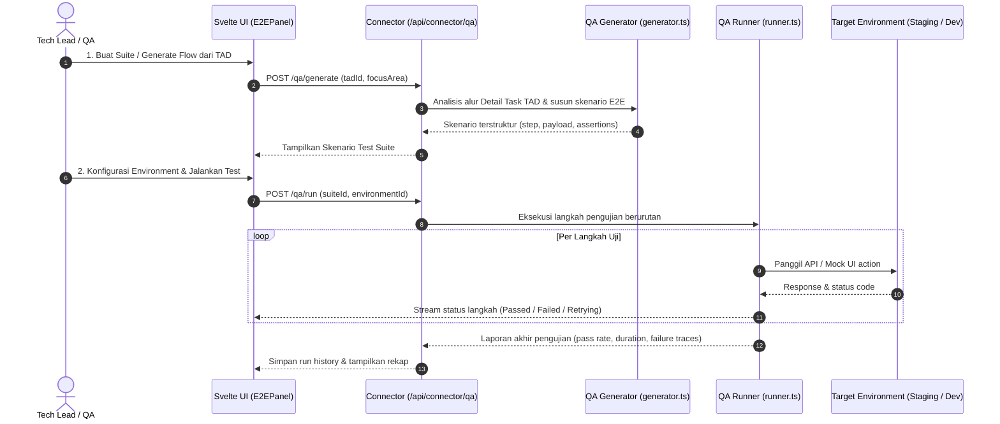

# Harness: QA Automation & E2E Test Engine

Modul ini mendokumentasikan fitur **QA Automation & E2E Testing**: generator skenario pengujian end-to-end berbasis spesifikasi TAD, manajemen environment (staging/dev), runner eksekusi otomatis, dan visualisasi hasil pengujian.

---

## 🎯 Ringkasan & Alur Kerja Fitur

QA Automation memudahkan verifikasi menyeluruh terhadap alur fitur lintas komponen:



---

## 📂 Peta File Source Code (QA Automation Module)

### Frontend (`src/projects/` & `src/lib/qa/`)
| File Path | Komponen | Deskripsi & Tanggung Jawab |
|---|---|---|
| [`src/projects/E2EPanel.svelte`](file:///Users/ridwan/mine/tech-lead-cockpit/src/projects/E2EPanel.svelte) | Panel Pengujian E2E | Antarmuka pembuatan test suite, daftar skenario uji, tombol run, dan ringkasan eksekusi test. Di tab E2E Test, seluruh kolom halaman Proyek ikut scroll (`.page-scroll` di `ProjectsView`). Header proyek ikut tergulung, baris judul E2E (environment, Generate, Jalankan) menempel di atas, dan tidak ada kotak scroll kecil di dalam panel. Tombol aksi kartu flow (`.flow-actions`) tetap di baris judul; judul dan badge membungkus di `.flow-meta`. |
| [`src/projects/E2EEnvironmentModal.svelte`](file:///Users/ridwan/mine/tech-lead-cockpit/src/projects/E2EEnvironmentModal.svelte) | Modal Manajemen Environment | Pengaturan URL base, auth token, dan mock variables untuk environment pengujian (Staging, Development, Local). Modal selebar 1080px. Base URL per service dan Variabel masing-masing selebar penuh, dan tinggi textarea mengikuti jumlah baris (`rowsFor`, 6–18 baris). |
| [`src/lib/qa/client.ts`](file:///Users/ridwan/mine/tech-lead-cockpit/src/lib/qa/client.ts) | QA API Client | Penghubung antarmuka UI dengan endpoint connector `/api/connector/qa/*`. |
| [`src/lib/qa/types.ts`](file:///Users/ridwan/mine/tech-lead-cockpit/src/lib/qa/types.ts) | Definisi Tipe Data QA | Schema untuk `QASuite` (termasuk `groups`), `QAScenario`, `QAStep`, `QAEnvironment`, dan `QARunResult`. |
| [`src/lib/qa/db-fill.ts`](../../../src/lib/qa/db-fill.ts) | Kesiapan & Isi dari DB | `notReady` (variabel tanpa nilai asli per test case, seluruh suite) dan `dbFillPlan` (variabel yang diisi dari DB, kredensial yang tetap di Keychain, test case terkait, instruksi otomatis). Test di [`db-fill.test.ts`](../../../src/lib/qa/db-fill.test.ts). |
| [`src/lib/qa/tad-findings.ts`](../../../src/lib/qa/tad-findings.ts) | Temuan untuk TAD | `collectFindings`: temuan E2E yang mungkin kelewat di TAD (catatan AI, test diperbaiki agent repair, pertanyaan coder agent, endpoint di luar rencana, test diubah lewat Perbaiki dengan AI, dugaan bug, test gagal); `likelyTad` memilih TAD tujuan; `buildTadUpdatePrompt` menyusun instruksi revisi. Test di [`tad-findings.test.ts`](../../../src/lib/qa/tad-findings.test.ts). |
| [`src/lib/qa/code-fix.ts`](../../../src/lib/qa/code-fix.ts) | Perbaiki Kode dari Test Gagal | `buildCodeFixSpec`: spesifikasi coder run bugfix dari flow yang gagal (step yang gagal, request/response tanpa header, assertion gagal, definisi test, Detail Task TAD, catatan); `failingService` untuk default repo; `e2eDraftId` = `e2e-<projectId>`. Test di [`code-fix.test.ts`](../../../src/lib/qa/code-fix.test.ts). |
| [`src/lib/qa/latest.ts`](../../../src/lib/qa/latest.ts) | Hasil Terakhir per Flow | `latestResults`: hasil final (lulus/gagal/error/diblokir) tiap flow dari run terbaru yang benar-benar menjalankannya di environment terpilih; `resultBucket`/`resultCounts` untuk filter dan hitungan. Test di [`latest.test.ts`](../../../src/lib/qa/latest.test.ts). |
| [`src/lib/qa/conflict.ts`](../../../src/lib/qa/conflict.ts) | Konflik Simpan | `handleConflict`: bila simpan ditolak karena versi lama (HTTP 409 `conflict`), tampilkan siapa yang menyimpan duluan dan tawarkan **Muat ulang**. Dipakai di E2EPanel (suite), E2EPipeline (rencana), E2EEnvironmentModal dan E2ERequirements (environment). |
| [`src/lib/qa/groups.ts`](../../../src/lib/qa/groups.ts) | Grup Test Case | Fungsi murni untuk grup di tab Skenario: urutan grup, tampilan per grup, status centang grup, tambah/ganti nama/hapus/urutkan grup, pindah flow antar grup dan di dalam grup. Dipakai UI dan connector. Test di [`groups.test.ts`](../../../src/lib/qa/groups.test.ts). |

### Backend Connector (`connector/qa/`)
| File Path | Komponen | Deskripsi & Tanggung Jawab |
|---|---|---|
| [`connector/qa/manager.ts`](file:///Users/ridwan/mine/tech-lead-cockpit/connector/qa/manager.ts) | QA Suite Manager | Logika suite, run, pipeline agent, dan environment (rahasia ke Keychain). Data disimpan lewat `QaStore` (`deps.store`, default file), `updated_by` dari `deps.actor`. Agent latar belakang menyimpan lewat `updateSuite` (baca ulang dan coba lagi maks. 3x bila konflik). |
| [`connector/qa/store.ts`](../../../connector/qa/store.ts) | Kontrak Store + File | Interface `QaStore`, `QaConflictError`, `KEEP_RUNS` (50), dan `FileQaStore` (layout file lama + kolom `version`, tulis atomik). |
| [`connector/qa/pg-store.ts`](../../../connector/qa/pg-store.ts) | Store PostgreSQL | `PgQaStore` (pool `pg`, maks. 4 koneksi), `MIGRATIONS` berversi di tabel `schema_version` (di bawah `pg_advisory_xact_lock`), `probe()` untuk Tes koneksi, pesan error koneksi yang bisa ditindaklanjuti (`QaStoreError`). |
| [`connector/qa/confluence-store.ts`](../../../connector/qa/confluence-store.ts) | Store Confluence | `ConfluenceQaStore`: halaman per proyek di bawah halaman induk, data di lampiran JSON, versi halaman sebagai kunci (lihat bagian Penyimpanan E2E). Seam `ConfluenceApi` (`ConfluenceClient` / fake di test). |
| [`src/lib/qa/merge.ts`](../../../src/lib/qa/merge.ts) | Gabung Otomatis | `mergeSuites(base, mine, theirs)`: gabung 3 arah per test case (id flow) dan per field suite; konflik hanya bila hal yang sama berubah di kedua sisi. |
| [`connector/qa/store-config.ts`](../../../connector/qa/store-config.ts) | Pemilih Store | `QaStoreSwitch` mengikuti Pengaturan: file, atau satu pool per koneksi/password. DB pusat yang dipilih tapi tidak lengkap memberi error di setiap panggilan, **tidak** jatuh diam-diam ke file. |
| [`connector/qa/store-migrate.ts`](../../../connector/qa/store-migrate.ts) | Pindah ke DB Pusat | `moveToCentral`: backup folder `qa` ke `~/.tech-lead-cockpit/qa-backups/<ts>-before-central`, lalu salin proyek, suite, rencana, environment, dan run. Tidak menimpa, file lokal tetap ada, aman diulang. |
| [`connector/qa/generator.ts`](file:///Users/ridwan/mine/tech-lead-cockpit/connector/qa/generator.ts) | AI Skenario Generator | Menganalisis dokumen arsitektur teknis untuk menghasilkan skenario pengujian realistis dengan validasi boundary & edge cases. |
| [`connector/qa/runner.ts`](file:///Users/ridwan/mine/tech-lead-cockpit/connector/qa/runner.ts) | Test Execution Engine | Mesin eksekutor HTTP requests, penegasan kondisi (*assertions*), logging error, dan penanganan timeout. |

---

## 🧭 Kelengkapan Input Generator (wajib dijaga)

Test case hanya selengkap input-nya. Tiga aturan ini mencegah journey kehilangan tahap (mis. tidak ada skenario create promo):

- **Task tidak pernah dipotong.** `POST /qa/generate` dan `POST /qa/plan` menerima maksimal `MAX_QA_TASKS` (200, `connector/qa/generator.ts`); lebih dari itu ditolak dengan pesan, bukan dipotong diam-diam. Task TAD kedua (mis. TAD CMS) biasanya ada di urutan akhir, jadi potongan selalu membuang tahap setup.
- **Codebase tidak gagal diam-diam.** `E2EPanel` membaca folder Services secara reaktif dari Pengaturan (`$derived(loadServicesRoot())`). Connector juga memakai folder di Pengaturan bila folder yang dikirim halaman tidak ada. Bila codebase tetap tidak terbaca, `prepareContext` mengembalikan `warning` dan catatan suite/rencana diawali `PERINGATAN: Codebase tidak terbaca (…)`.
- **Setup lewat API.** Prompt planner dan writer mewajibkan tahap pertama membuat data master lewat API-nya (create → approval → aktivasi), dicari di Detail Task dan router codebase (group cms/admin/backoffice). Seed hanya dipakai bila API-nya tidak ada. `uncoveredTasks` (`connector/qa/plan.ts`) menulis peringatan di catatan rencana untuk task API/integrasi/scheduler yang tidak masuk tahap mana pun. Task model, tabel, dan boilerplate hanya konteks.

---

## 🔢 Tipe variabel di request

Runner ([`connector/qa/runner.ts`](../../../connector/qa/runner.ts)) menentukan tipe JSON nilai yang isinya tepat satu variabel (`"field": "{{x}}"`):

1. **Cast eksplisit** menang: `"{{x|string}}"`, `"{{x|number}}"`, `"{{x|boolean}}"`, `"{{x|json}}"`. Di dalam teks (`"kode {{x|string}}"`) cast diabaikan.
2. **Tipe yang dideklarasikan suite** (`declaredTypes`): bila variabel itu di-cast di step mana pun dalam suite (`{{actorCreator|string}}`), pemakaian tanpa cast ikut tipe itu. Ini berlaku juga saat flow dijalankan sendiri, karena deklarasi dihitung dari seluruh suite, bukan hanya flow yang dipilih. Variabel yang di-cast ke dua tipe berbeda tidak dideklarasikan. Aturan ini menang atas tipe hasil `extract` flow sebelumnya. Tanpa aturan ini hasil tergantung urutan run: jalan sendiri, `"{{actorCreator}}"` berisi `1024` dikirim sebagai number dan service menolak karena tipe salah (test negatif "lulus" palsu); jalan bersama, flow pertama sudah meng-extract `created_by` sebagai string.
3. **Hasil `extract`** memakai tipe aslinya dari response (`"00123"` tetap string, `77` tetap number, objek tetap objek), juga saat dibawa ke flow berikutnya (`carried.types`).
4. **Tanpa ketiganya**, hanya angka aman yang dikirim sebagai number: tanpa nol di depan dan maksimal 15 digit. Nomor HP `0812…` dan nomor rekening panjang tetap string. Dulu semua string berisi angka diubah jadi number, dan `0812…` membuat step crash.

Prompt penulis, perbaikan, dan repair meminta AI menulis cast sesuai tipe di struct request.

Assertion `equals`/`contains`/`gt`/… tanpa nilai harapan gagal dengan pesan "nilai yang diharapkan belum diisi", bukan "not equal" polos. Di editor flow, string kosong ditampilkan dan ditulis sebagai `""`; kotak yang dikosongkan berarti tanpa nilai. Dulu `""` hilang saat flow diedit lalu disimpan.

---

## 🗂️ Grup test case (tab Skenario)

Grup sebuah flow adalah `flow.stage`: tahap dari rencana journey, atau grup yang dibuat sendiri. Flow tanpa `stage` masuk **Tanpa grup**, yang selalu tampil paling bawah. `QASuite.groups` menyimpan urutan grup, termasuk grup yang masih kosong. Grup yang hanya ada di flow (belum tersimpan di `groups`) menyusul sesuai urutan kemunculannya (`groupOrder`).

- **Checklist per grup.** Tiap judul grup punya checkbox tiga keadaan: semua, sebagian (`indeterminate`), atau kosong (`groupCheck`). Di sebelahnya ada hitungan dicentang/total (mis. `3/5`). Mengklik checkbox grup mencentang atau mengosongkan semua flow di grup itu (`setGroupEnabled`). Hitungan selalu atas semua flow di grup, juga saat pencarian aktif. Tombol **Jalankan N flow** mengikuti centangan.
- **Grup manual.**
  - **Grup baru** (di toolbar, juga di tampilan kosong) membuat grup kosong. Grup kosong tetap tampil, kecuali saat pencarian aktif.
  - Tiap grup punya tombol + (flow manual di grup itu), ↑/↓ (urutan grup), ganti nama, dan hapus. Menghapus grup memindahkan flow-nya ke Tanpa grup; flow-nya tidak ikut terhapus.
  - Nama dirapikan (`cleanGroupName`, maks 120 karakter, satu baris). Nama tidak boleh kosong, kembar (tanpa beda huruf besar/kecil), atau "Tanpa grup".
- **Pindah flow.**
  - Dropdown grup di kartu flow memindahkan flow ke grup lain, ke Tanpa grup, atau ke **+ Grup baru…**. Flow yang dipindah masuk di akhir grup tujuan.
  - Di FlowEditor, isian **Grup** menawarkan grup yang ada (datalist); mengetik nama baru membuat grup baru.
  - ↑/↓ di kartu hanya memindah flow di dalam grupnya (`moveFlowInGroup`).
- **Urutan run = urutan tampil.** Setiap perubahan grup menata ulang `suite.flows` per grup (`withGroups`/`arrangeFlows`), lalu urutan di dalam grup tetap. Runner menjalankan flow sesuai urutan itu.
- **Connector.** `POST /qa/suite` membersihkan `groups` (`normalizeGroups`) dan menata ulang flow (`withGroups`) sebelum menyimpan. Saat agent penulis menggabungkan tahap (`writeFromPlan` → `merge`), urutan grup yang tersimpan dipakai. Tahap rencana yang belum ada di `groups` menyusul dalam urutan rencana, dan `groups` sendiri tidak ditimpa oleh merge, supaya tahap yang selesai duluan tidak mengunci urutan.
- **Kompatibilitas rencana.**
  - Agent penulis mengganti flow per **judul** tahap rencana. Grup manual dengan nama di luar rencana diperlakukan seperti flow manual: tidak pernah diganti.
  - Ganti nama grup yang judulnya tahap rencana dikonfirmasi dulu. Bila tahap itu ditulis ulang, test case-nya masuk lagi ke grup bernama lama, dan flow di grup yang sudah diganti namanya tidak ikut diganti.
  - Menghapus grup tahap rencana juga diberi peringatan yang sama.

## ✅ Status lulus di tab Skenario

Tab Skenario menampilkan hasil tiap flow tanpa perlu membuka Hasil Run.

- **Sumber data.** `latestResults(runs, env.id)` mengambil hasil dari run terbaru yang benar-benar menjalankan flow itu di environment terpilih. Run berisi satu flow juga dihitung. Hasil yang belum final (berjalan, menunggu, dilewati karena run dibatalkan) tidak menimpa hasil sebelumnya, dan hasil dari environment lain tidak dipakai.
- **Kartu flow.** Badge `Lulus · 22/10, 14.15` (atau Gagal/Error/Diblokir) muncul dengan tooltip waktu dan environment. Mengklik badge membuka run itu di tab Hasil Run. Flow yang belum pernah dijalankan diberi badge "Belum dijalankan". Saat run berjalan, badge "Berjalan"/"Menunggu" muncul di sampingnya.
- **Judul grup.** Ringkasan `✓ n lulus · ✗ n gagal · n belum` atas semua flow di grup.
- **Filter.** Chip Semua / Lulus / Gagal / Belum dijalankan beserta jumlahnya, digabung dengan pencarian dan kategori. Saat filter atau pencarian aktif, tombolnya menjadi **Centang yang tampil** / **Kosongkan yang tampil** dan hanya mengubah flow yang tampil. Ini memudahkan menjalankan ulang yang gagal saja.

## 📘 Update TAD dari temuan E2E

Tombol **Update TAD dari temuan (n)** di toolbar Skenario mengirim temuan pengujian yang kelewat atau ambigu di TAD ke revisi AI TAD, sebagai job background.

- **Temuan** (`collectFindings`):
  - **Dicentang otomatis:** catatan/asumsi AI di suite, test yang diperbaiki agent repair karena beda dengan kode (`repairNote` "Test diperbaiki: …"), dan pertanyaan coder agent (run Perbaiki kode berstatus `needs-input` dengan `BUTUH KLARIFIKASI:`).
  - **Ditampilkan tapi tidak dicentang:** endpoint di luar rencana, test yang diubah lewat Perbaiki dengan AI ("Diperbaiki AI: …"), dugaan bug service, dan test yang gagal. Temuan jenis ini lebih sering soal test atau kode daripada celah di TAD.
  - Kegagalan karena lingkungan tidak dihitung.
- **Dialog:**
  - **TAD tujuan:** default ke TAD yang paling banyak disebut oleh temuan (lewat judul task, `likelyTad`). Temuan untuk TAD lain ditandai dan tidak dicentang.
  - **Isi lain:** checklist per jenis, catatan tambahan, dan pilihan AI.
- **Instruksi** (`buildTadUpdatePrompt`). AI hanya melengkapi atau memperjelas bagian yang kelewat (Detail Task: validasi, kode error, response, alur, aturan bisnis). TAD tidak diubah untuk menyesuaikan kode yang salah. AI tidak mengarang aturan di luar temuan, dan mengakhiri dengan ringkasan per temuan: diterapkan atau tidak, beserta alasannya.
- **Background dan review.** Job jalan lewat `startGeneratorJob` dengan `pendingReview: true`. Tab E2E memantau job dan menyerahkannya dengan `finishGeneratorJob`, jadi hasilnya selalu jadi usulan di TAD (lihat [TAD Workspace](../tad/index.md#update-tad-dari-temuan-e2e)). Banner di tab E2E menampilkan "AI memperbarui TAD …" lalu "Usulan perubahan TAD … menunggu review", dengan tombol **Review di TAD**.

## 🧑‍💻 Perbaiki kode dari test yang gagal (background, tanpa tiket)

Untuk test case yang gagal karena kode service (bukan test-nya), tombol **Perbaiki kode** (ikon kode di kartu flow yang hasil terakhirnya gagal, dan tombol di flow gagal pada Hasil Run) menjalankan coder agent di background.

- **Dialog.** Repo (default dari service step yang gagal, lewat `suggestRepo`), profil Backend/Frontend, base branch, catatan, dan pratinjau spesifikasi. Base branch dipilih dari branch yang benar-benar ada di repo itu (`GET /coder/branches`): dari GitLab bila terjangkau, selain itu dari salinan lokal. Defaultnya `pickBaseBranch`: default di Pengaturan, lalu staging, development, develop, main, master, lalu default branch repo. Jadi repo yang hanya punya `main` tidak gagal karena `staging`/`development` tidak ada. Target MR = base branch. **Nama branch** bisa diubah: terisi `fix/<nama test case>` (aturan yang sama dengan connector, `branchName`), divalidasi `branchNameError` (huruf, angka, `.` `_` `-` `/`, tanpa spasi, tanpa `..`/`//`, bukan branch utama seperti main/staging), dan diberi peringatan bila branch itu sudah ada di repo.
- **Spesifikasi.** Disusun di frontend oleh `buildCodeFixSpec`, lalu dikirim lewat `POST /coder/runs` biasa dengan `kind: 'bugfix'` dan `source: { kind: 'e2e', projectId, flowId, flowName, qaRunId }`. Header request tidak ikut, karena memuat auth environment. Agent diminta memastikan dulu kegagalannya di kode. Bila test-nya yang keliru, agent berhenti dengan `BUTUH KLARIFIKASI:`; test diperbaiki lewat **Perbaiki dengan AI**.
- **Step yang belum diuji ikut diperbaiki.** Step sesudah step yang gagal (dilewati runner) tidak pernah dicek, jadi spesifikasi memuat definisinya (request, body, ekspektasi via `describeAssertion`). Agent memeriksa dan memperbaiki semuanya dalam satu run, bukan satu step per run ulang.
- **Banyak test sekaligus.**
  - Tombol **Perbaiki kode (n gagal)** di baris filter hasil membuka dialog berisi semua test yang gagal, kecuali yang perbaikannya masih berjalan. Saat pencarian atau filter aktif, hanya yang tampil yang dicentang.
  - Repo per test terisi otomatis dan bisa diubah. Test dikelompokkan per repo: satu run per repo berisi maksimal `MAX_FLOWS_PER_FIX` (6) test case (`chunkFixes`). `buildMultiCodeFixSpec` memuat tiap kegagalan, dan Detail Task TAD hanya sekali.
  - Base branch dan nama branch diatur per repo. Nama default-nya `fix/<grup>` bila semua test ada di satu grup, selain itu `fix/perbaikan-<n>-test-case`. Run berikutnya di repo yang sama memakai `-2`, `-3`.
  - Run di satu repo tidak pernah berjalan bersamaan (aturan coder), sedangkan repo berbeda berjalan paralel sampai batas konkurensi coder.
  - `source.flowIds` mencatat semua test case dalam satu run, sehingga badge status perbaikan muncul di setiap kartunya.
- **Tanpa tiket.** Tidak ada kasus Bug Tracing atau tiket Jira yang dibuat. Branch-nya `fix/<nama test case>` (judul `[BUGFIX][REPO][E2E] - <flow>`, tanpa awalan `agent-`). Tidak ada Jira key, jadi tidak ada status Jira yang digeser; Jira key task TAD sengaja tidak dipakai supaya Push tidak menggeser tiket yang sudah jalan.
- **Background.** Run masuk antrean coder biasa (clone terisolasi, batas konkurensi) dan tampil di Agent Tasks. Tombol di Agent Tasks membuka `#/projects/<id>?tab=e2e`.
- **Review.** Panel **Perbaikan kode dari test yang gagal** di tab E2E memakai `AgentRunsPanel` dengan draft semu `e2e-<projectId>` (diff, revisi, Push & MR Draft). Kartu flow menampilkan badge status perbaikan (agent bekerja, siap direview, …); badge diklik untuk ke panel. Status dipantau tiap 5 detik selama ada run aktif. Selama satu run masih aktif, tombol Perbaiki kode untuk flow itu nonaktif.

## 🛠️ Perbaiki dengan AI (instruksi)

Tombol **Perbaiki dengan AI** di daftar skenario (atau ikon ✨ per flow) membuka panel berisi instruksi bebas, preset (tipe data sesuai struct, test yang gagal di run terakhir, nama field/path sesuai kode), cakupan (yang dicentang, hasil pencarian, atau satu flow), dan pilihan AI. `QaManager.fixFlows` (`POST /qa/fix`) menjalankan agent peran `fix` per 5 flow (maksimal 80 flow), dengan concurrency pipeline. Prompt `buildFixPrompt` ([`connector/qa/plan.ts`](../../../connector/qa/plan.ts)) berisi instruksi, JSON flow, dan ringkasan hasil run terakhir tiap flow. Agent membaca struct/router/handler (hanya baca).

`parseFix` hanya menerima flow dengan id yang dikirim. Id step dan `stage` dipertahankan, dan flow yang kembali tanpa perubahan diabaikan. Id step selalu unik dalam satu flow. Bila AI (atau edit manual) menyalin step beserta id-nya, hanya step pertama yang memakai id itu (`normalizeEditedFlow`). Pemulihan id per posisi juga tidak memakai id yang sudah dipakai. Suite lama yang sudah punya id dobel dipulihkan sekali saat dimuat (`dedupeStepIds` di `QaManager.getSuite`, lalu disimpan). Di tab Hasil Run, step diberi key berdasarkan posisi, karena run lama bisa mengulang `stepId`. Tanpa ini Svelte melempar `each_key_duplicate`. Flow yang berubah diberi `repairNote` "Diperbaiki AI: …". Versi sebelumnya disimpan di `suite.undo` (satu tingkat). **Batalkan perbaikan** (`POST /qa/fix/undo`) mengembalikannya.

---

## 🧾 Membaca jawaban JSON dari AI

`extractJson` dan `repairJson` ada di [`connector/ai-json.ts`](../../../connector/ai-json.ts) (diekspor ulang oleh `connector/qa/generator.ts`) dan dipakai agent QA, bug tracing, dan estimasi. JSON yang valid dipakai apa adanya. Hanya JSON yang gagal di-parse yang diperbaiki, dan perbaikannya (variabel `{{x}}` tanpa kutip, koma di akhir) hanya menyentuh bagian **di luar string**. Dulu perbaikan berbasis regex juga mengenai teks seperti `({{a}}, {{b}}, {{c}})` di `notes`/`description`, sehingga JSON yang sebenarnya valid jadi rusak dan agent penulis gagal dengan "JSON dari AI tidak valid".

---

## 🛠️ Ubah data DB untuk setup test (`step.setup`)

Ada kondisi yang tidak bisa dibuat lewat API, misalnya promo yang tanggal mulainya sudah lewat, kuota yang habis, atau status yang kedaluwarsa. Untuk itu sebuah step boleh punya `setup`: daftar `{ db, sql }` yang dijalankan **tepat sebelum request step itu**.

- **Izin per environment.** Kolom `QAEnvironment.dbWrites` ("Izinkan ubah data DB untuk setup test" di modal Environment). Default mati. `validateEnvironment` membuangnya bila environment Read-only. Tanpa izin, step yang punya setup **gagal dengan pesan jelas** dan tidak mengirim request, supaya tidak berjalan di atas data yang tidak siap.
- **Pengaman SQL** (`assertSetupSql`/`executeSetup` di [`connector/qa/db.ts`](../../../connector/qa/db.ts)):
  - Hanya satu perintah, berupa `UPDATE`/`INSERT`/`DELETE`. `UPDATE`/`DELETE` wajib punya `WHERE`.
  - Ditolak: DDL, izin (GRANT/REVOKE), perintah sesi, dan perintah ganda.
  - Dijalankan di transaksi sendiri lalu di-commit. Bila baris yang berubah lebih dari `MAX_SETUP_ROWS` (20), transaksinya di-rollback.
  - Nilai variabel dimasukkan ke SQL dengan kutip tunggal digandakan (`runSetup` di runner), sehingga nilai dari response tidak bisa menutup string literal.
  - `dataQueries` dan assertion `db` tetap read-only.
- **Jejak.**
  - Hasil run menyimpan `step.dbSetup` (SQL dan jumlah baris yang berubah), yang tampil di tab Hasil Run.
  - Dialog konfirmasi run menyebut jumlah step yang mengubah data dan database-nya.
  - Entri audit `qa.run` mencatat "n ubah data DB: <db>".
  - Kartu flow menampilkan baris "Ubah data DB …" di atas step-nya.
- **Edit dan AI.**
  - FlowEditor punya isian "Ubah data DB sebelum request" (`nama_db: UPDATE …`, satu per baris). `normalizeEditedFlow` membuang pernyataan yang tidak lolos pengaman.
  - Prompt penulis, perbaikan, dan repair memuat `DB_SETUP_RULES` hanya bila environment-nya `dbWrites` (`prepareContext` mengisi `req.dbWrites`). AI diminta memakai setup hanya untuk kondisi yang tidak bisa dibuat lewat API, dengan WHERE yang menyasar data milik test.

## ✅ Semua test case siap dijalankan (isi otomatis dari database)

Di atas panel "Yang perlu diatur", banner menunjukkan berapa test case dari **seluruh suite** yang belum siap dijalankan. Hitungannya memakai `notReady`/`dbFillPlan` ([`src/lib/qa/db-fill.ts`](../../../src/lib/qa/db-fill.ts)) di atas `e2eRequirements`: variabel yang kosong atau masih contoh AI. Nilai di environment, hasil `extract`, dan query DB dihitung sebagai siap.

- **Tanda di kartu.** Kartu yang belum siap diberi badge "Belum siap · n variabel", dan tooltip-nya berisi nama variabelnya.
- **Isi otomatis dari database.** Bila environment punya database, tombol ini menjalankan agent perbaikan (`fixFlows`, background, bisa dibatalkan lewat **Batalkan perbaikan**) dengan instruksi buatan otomatis dan `environmentId`. Agent membaca skema database service terkait dan menambahkan `dataQueries` (SELECT, LIMIT 1, kondisi sesuai skenario) untuk variabel itu, tanpa mengubah step lain. Variabel hasil `extract` dibiarkan. Aturan ditulis di depan daftar variabel, dan batas instruksi `fixFlows` dinaikkan ke 12.000 karakter. Paling banyak 80 test case per klik; sisanya lewat klik berikutnya.
- **Kredensial** (PIN, password, token, signature: `SENSITIVE`) tidak pernah diambil dari database. Banner menyebutkannya supaya diisi sekali di Variabel rahasia environment.
- **Skema DB untuk agent lain.** **Perbaiki dengan AI** mengirim environment terpilih, dan agent **repair** memakai environment run yang gagal. Keduanya menerima skema DB (`buildFixPrompt`/`buildRepairPrompt` dengan `databaseSection`), jadi data uji yang hilang atau kedaluwarsa bisa diganti query.

## 🔑 Panel "Yang perlu diatur" (variabel environment)

[`src/projects/E2ERequirements.svelte`](../../../src/projects/E2ERequirements.svelte) tampil di atas tab Skenario/Hasil Run. Panel ini menghitung, untuk flow yang dicentang dan environment terpilih, key yang masih harus diisi. Logikanya ada di fungsi murni `e2eRequirements` ([`src/lib/qa/requirements.ts`](../../../src/lib/qa/requirements.ts)) dan urutannya sama dengan runner:

| Status | Arti |
|---|---|
| `missing` | `{{nama}}` dipakai di path, header, query, body, assertion, atau `dataQueries`, tapi tidak punya nilai dari mana pun |
| `example` | Hanya ada nilai contoh AI di flow; tetap dipakai saat run, tapi jarang berupa data uji asli |
| `set` / `secret` | Ada di Variabel environment, atau di Variabel rahasia (Keychain) |
| `auto` | Di-extract dari response step/flow lain, diisi `dataQueries` (bila environment punya database), atau contohnya dibangun dari built-in (`E2E-{{$timestamp}}`) |

Built-in (`QA_BUILTIN_VARS`) tidak pernah dihitung. Panel juga menandai service tanpa base URL sendiri maupun default, dan token auth yang belum disimpan padahal ada step yang memakai auth environment. Nilai bisa diisi langsung, lalu disimpan lewat `qa.saveEnvironment`. Nama yang tampak seperti kredensial (password/pin/otp/token/secret/key) otomatis dicentang **Rahasia** sehingga masuk Keychain; variabel rahasia lama tetap dipertahankan karena dikirim sebagai nama dengan nilai kosong. **Salin daftar key** menyalin `nama = ` per baris untuk dibagikan ke QA.

---

## 🗄️ Penyimpanan E2E: file lokal atau DB pusat (PostgreSQL)

Data E2E (proyek, suite beserta grup, rencana journey, riwayat run, dan environment) disimpan lewat `QaStore`. Pilihannya ada di **Koneksi → Penyimpanan E2E** (`settings.qaStore`):

| Mode | Lokasi | Untuk |
|---|---|---|
| `file` (default) | `~/.tech-lead-cockpit/qa/`: `suites/<projectId>.json`, `plans/<projectId>.json`, `runs/<projectId>/<runId>.json`, `environments.json`, `projects.json` | Satu orang di satu laptop |
| `confluence` | Halaman di bawah satu halaman induk (`confluenceSpace`, `confluenceParentId`), memakai koneksi Confluence app | Tech Lead Cockpit dan QA Cockpit memakai data yang sama (pilihan utama) |
| `postgres` | Database bersama (mis. `tlc_qa` di server PostgreSQL dev) | Alternatif bila ada server PostgreSQL bersama |

### Mode Confluence
```
<halaman induk>
├── API Testing · Environment                 environments.json
└── <proyek> · API Testing                    project.json, suite.json   (isi: ringkasan)   label qa-project-<id>
    ├── <proyek> · API Testing · Rencana      plan.json                                     label qa-plan-<id>
    └── <proyek> · API Testing · Run          run-<id>.json (50 terbaru)                    label qa-runs-<id>
```
- **Halaman dikenali dari label, bukan judul.** Judul tetap rapi; nama yang sudah dipakai di space mendapat akhiran ` (2)`. Mengganti nama proyek ikut mengganti judul halaman. Halaman versi pertama (ID di judul, `… · API Testing [<id>]`) otomatis diberi label dan dirapikan judulnya saat pertama dibaca. Format ini (`connector/qa/confluence-store.ts`) harus identik dengan QA Cockpit.
- **Lampiran JSON adalah data; isi halaman hanya ringkasan** (grup, test case, kategori, jumlah step) dengan catatan "dikelola Cockpit, jangan diedit manual".
- **Kunci = versi halaman.** Simpan: baca versi halaman → bila beda dari versi yang dimuat, `QaConflictError` → update halaman ke versi+1 (Confluence menolak 409 bila ada yang mendahului) → baru lampiran ditulis (`putAttachment`, gagal = error, tidak ditelan). Rencana dan environment punya halaman sendiri, jadi tidak saling mengunci dengan test case. Run tanpa kunci (tiap run file baru); yang lebih lama dari 50 dihapus.
- **Environment:** satu halaman untuk semua; environment baru tidak pernah bentrok, edit environment dengan versi lama ditolak.
- **Akun bersama:** riwayat Confluence mencatat akun app; pengubah asli dicatat app (`updatedBy` di JSON, isi halaman, dan pesan versi).
- **Tes koneksi** membaca halaman induk dan memeriksa izin `update` (`canUpdate`, `?expand=operations`); halaman yang terbaca tapi tidak boleh diubah ditolak dengan pesan jelas.
- Proyek baru dibuat otomatis saat pertama disimpan; `upsertProject` (tab E2E) membuat halaman proyek dan `project.json` (nama + TAD) yang dibaca QA Cockpit saat Import.

### Gabung otomatis per test case
`QaManager.saveSuite` mengingat suite yang terakhir dikirim per versi (`served`). Bila simpan kalah balapan (`QaConflictError`), suite terbaru dibaca dan `mergeSuites(base, mine, theirs)` menggabungkan:
- test case yang diubah di satu sisi saja, tambahan, dan penghapusan;
- urutan (milik saya bila hanya saya yang mengubah urutan), daftar grup (gabungan), field suite lain.
Hanya test case yang sama (atau field suite yang sama, mis. catatan) yang berubah di kedua sisi menjadi konflik: `QaConflictError` dengan daftar yang bentrok ("Test case "X" sudah diubah oleh Y pada Z"). Berlaku untuk semua mode (file, Confluence, PostgreSQL).

### 🧾 Evidence run ke Confluence
Tombol **Kirim evidence** di hasil run ([`EvidenceButton.svelte`](../../../src/projects/EvidenceButton.svelte), dengan konfirmasi) membuat halaman evidence yang bisa dibaca orang di bawah halaman Run proyek: `Evidence <proyek> · <waktu> · <environment> (x/y lulus)`, label `qa-evidence` dan `qa-evidence-<runId>`. Isinya ([`src/lib/qa/evidence.ts`](../../../src/lib/qa/evidence.ts), storage format, identik di TL dan QA Cockpit):
- ringkasan (proyek, environment, mulai/selesai, jumlah lulus/gagal, pengirim, id run) dan tabel test case dengan lozenge status;
- per test case: data uji dari DB, lalu tiap step dalam blok expand: setup DB, request (method, URL, header, body), response, tabel ekspektasi (hasil, aktual), cek data, variabel yang diambil, curl;
- body > 6.000 karakter dipotong; halaman > ~3 MB berhenti menampilkan detail step (ada catatan); lampiran `run-<id>.json` berisi run utuh.
Data diambil dari run apa adanya: token dan password sudah disamarkan runner. Kirim ulang memperbarui halaman yang sama (dicari lewat label). Link evidence disimpan di run (`run.evidence`), lalu tombol berubah jadi **Lihat evidence** + perbarui. Hanya untuk penyimpanan Confluence (`QaStore.saveEvidence`). Audit `qa.evidence`.

### 📦 Import / export environment
Tombol **Export** dan **Import** di modal Environment ([`EnvTransfer.svelte`](../../../src/projects/EnvTransfer.svelte), logika [`connector/qa/env-transfer.ts`](../../../connector/qa/env-transfer.ts), keduanya identik di Tech Lead Cockpit dan QA Cockpit). Untuk memindahkan environment antar laptop, antar workspace, atau antara TL dan QA Cockpit.
- **File** `cockpit-environment-<tanggal>.json` (format `cockpit-environments`, versi 1) ditulis connector ke `~/Downloads` (0600), karena webview desktop tidak bisa download. Isinya konfigurasi environment tanpa field status Keychain dan versi.
- **Rahasia** (token auth, variabel rahasia, password server DB, password DB per database) ikut bila dicentang, **hanya terenkripsi**: scrypt (N=2^15) + AES-256-GCM dengan passphrase yang diketik user (min. 8 karakter, tidak disimpan). Tanpa passphrase, file tidak berisi rahasia.
- **Import**: pilih file → preview (`POST /qa/environments/import/preview`, tidak menyimpan apa pun): cocok dengan environment di sini berdasarkan id lalu nama, daftar rahasia yang dibawa, error validasi. Per environment: **Ganti** (menimpa yang cocok dengan versinya; rahasia hanya diganti bila ada di file), **Tambah baru** (nama kembar diberi " (2)"), atau **Lewati**. Konfirmasi dulu karena tersimpan ke penyimpanan bersama; rahasia masuk Keychain laptop ini lewat `saveEnvironment`.
- **Audit**: `qa.env.export` (lokasi file, jumlah, ada rahasia atau tidak) dan `qa.env.import`.

### Review sebelum kirim (draft lokal)
Dengan penyimpanan bersama, perubahan test case **tidak langsung** ke Confluence. `DraftedQaStore` ([`connector/qa/drafts.ts`](../../../connector/qa/drafts.ts)) membungkus store bersama: setiap simpan suite (edit manual, generate, agent penulis, repair, Perbaiki dengan AI, undo) masuk ke draft lokal `<data>/qa-drafts/<projectId>.json` (0600). Rencana, run, environment, dan proyek tetap langsung ke store bersama.
- **Draft** menyimpan suite terbit saat draft dimulai (`base`), suite draft, dan revisi lokal `draftRev`. Simpan ke draft wajib membawa `draftRev` yang dimuat; kalau tidak, 409 lalu `QaManager` menggabung per test case seperti biasa (kunci `served` = versi + `draftRev`). Kembali sama dengan yang terbit = draft dihapus.
- **Perubahan orang lain** yang terkirim sementara itu digabung ke draft saat suite dibaca bila menyentuh test case lain. Bila menyentuh test case yang sama, draft ditandai `behind` dan test case itu muncul sebagai **bentrok** di review.
- **Review** (`GET /qa/suite/review`): `diffSuites(base, draft)` ([`src/lib/qa/suite-diff.ts`](../../../src/lib/qa/suite-diff.ts)) per test case (baru/diubah/dihapus, baris per field dan step, perbandingan JSON) plus catatan, urutan grup, dan dugaan bug.
- **Kirim** (`POST /qa/suite/publish`, semua atau `keys` terpilih, dengan konfirmasi): `applyChanges(base, draft, keys)` lalu simpan ke store bersama dengan versinya (digabung `mergeSuites` bila sudah bergeser; test case bentrok ditolak 409). Sisanya tetap di draft di atas versi baru. Audit `qa.suite.publish`.
- **Buang** (`POST /qa/suite/discard`, semua atau per test case) mengembalikan test case ke versi terbit.
- UI: banner "N perubahan test case belum dikirim" dan dialog [`SuiteReview.svelte`](../../../src/projects/SuiteReview.svelte) di panel. `drafts.ts`, `suite-diff.ts`, dan `SuiteReview.svelte` **identik** di Tech Lead Cockpit dan QA Cockpit.

- **Tabel** (dibuat dan di-upgrade oleh app, `MIGRATIONS` di `pg-store.ts`, tercatat di `schema_version`): `qa_projects` (id, name, `tads` jsonb: judul, draftId, Confluence page id/url, Jira keys), `qa_suites`/`qa_plans`/`qa_environments` (`data` jsonb, `version`, `updated_at`, `updated_by`), `qa_runs` (id, project_id, started_at, status, environment_id, summary, data). Migrasi baru = tambah entri ke `MIGRATIONS`, jangan ubah yang sudah ada. App yang lebih lama dari skema menolak jalan ("Perbarui app dulu").
- **Tanpa rahasia.** Token, password DB, dan variabel rahasia environment tetap di Keychain tiap user dengan kunci `env:<id>` yang sama, jadi environment bersama dipakai dengan kredensial masing-masing. `storableEnvironment` membuang field status Keychain sebelum disimpan.
- **Konflik simpan (optimistic concurrency).** Suite, rencana, dan environment membawa `version`. Simpan hanya berhasil bila versinya masih sama (`UPDATE … WHERE version = $expected`, buat baru = `version` 0). Bila tidak, connector membalas **409** `{ code: 'conflict', updatedBy, updatedAt }` dengan pesan "… sudah diubah oleh X pada Y. Perubahan Anda belum disimpan", lalu UI menawarkan **Muat ulang** (`handleConflict`). Tidak pernah menimpa diam-diam. Hasil generate dan rencana baru dari agent disimpan di atas versi saat job dimulai. Agent penulis, repair, dan perbaikan membaca ulang lalu menerapkan perubahannya lagi (`updateSuite`).
- **Siapa yang menyimpan.** `updated_by` = email atau nama di Pengaturan (`settings.identity`), bila kosong email git global, lalu user macOS. Nilai ini diisi sendiri oleh user (satu login DB bersama), jadi bukan bukti identitas.
- **Run.** Run selesai di-insert sekali (tidak berubah lagi), 50 run terbaru per proyek disimpan. Run yang sedang berjalan tetap hanya di memori proses yang menjalankannya.
- **Proyek untuk QA.** Panel E2E di Cockpit TL memanggil `POST /qa/projects` saat proyek dibuka: nama dan referensi TAD (tanpa isi draft). Penulisan hanya terjadi bila ada yang berubah. `saveSuite` di PostgreSQL juga membuat baris proyek bila belum ada.
- **Pindahkan data lokal ke DB pusat** (tombol di kartu Penyimpanan E2E, dengan konfirmasi): backup dulu, salin semua, lewati dan laporkan item yang sudah ada di DB dengan isi berbeda, catat audit `qa.store.migrate`.
- **Suite per-TAD lama** (`adoptLegacy`) hanya diadopsi di mode file.
- **Membuat database** di server bersama: [`scripts/sql/qa-central-db.sql`](../../../scripts/sql/qa-central-db.sql) (`psql -v app_user=<login> -f …`). Isinya hanya `CREATE DATABASE tlc_qa OWNER <login>` dan pembatasan CONNECT. Dijalankan admin, sekali, setelah disetujui.

| Endpoint | Fungsi |
|---|---|
| `GET /qa/store` | Mode aktif dan target (`host:port/db`) |
| `POST /qa/store/test` | Tes isian form (belum disimpan) atau yang tersimpan: PostgreSQL (versi server dan skema, tanpa membuat tabel) atau Confluence (halaman induk dan izin edit). Balasan `{ summary }` |
| `POST /qa/store/migrate` | Backup lalu salin data lokal ke penyimpanan bersama (Confluence atau DB pusat), audit |
| `GET /qa/projects`, `POST /qa/projects` | Daftar proyek; upsert nama dan TAD |
| `GET /qa/suite/review` | Perubahan draft lokal per test case dan yang bentrok |
| `POST /qa/suite/publish` | Kirim perubahan draft (semua atau `keys`) ke store bersama, audit `qa.suite.publish` |
| `POST /qa/suite/discard` | Buang perubahan draft (semua atau `keys`) |
| `POST /qa/environments/export` | Tulis file export ke ~/Downloads (`ids`, `passphrase` opsional untuk rahasia terenkripsi), audit |
| `POST /qa/environments/import/preview` | Isi file export dicocokkan dengan environment di sini (tanpa menyimpan) |
| `POST /qa/environments/import` | Simpan environment dari file per tindakan (`replace`/`new`/`skip`), rahasia ke Keychain, audit |
| `POST /qa/runs/evidence` | Buat/perbarui halaman evidence run di Confluence (`projectId`, `runId`), audit `qa.evidence` |

---

## 🛠️ Panduan Development & Debugging

### Menjalankan Unit Test QA Engine
```bash
npm test connector/qa/qa.test.ts
npm test connector/qa/store.test.ts   # kontrak store file + PostgreSQL (pg-mem), konflik, migrasi data
```

Test PostgreSQL memakai **pg-mem** (in-memory). Di sana `pg_advisory_xact_lock` didaftarkan sebagai fungsi kosong, dan `noAstCoverageCheck` dinyalakan (pg-mem tidak membaca `CREATE TABLE IF NOT EXISTS` pada tabel yang sudah ada). Perilaku `INSERT … ON CONFLICT DO NOTHING RETURNING` di pg-mem berbeda dari PostgreSQL, jadi pembuatan baris memakai INSERT biasa dan menangkap `23505`.

> [!NOTE]
> Setelah melakukan perubahan pada modul QA Automation, pastikan Anda memperbarui dokumen ini jika terdapat modifikasi struktur schema skenario test atau runner API!
