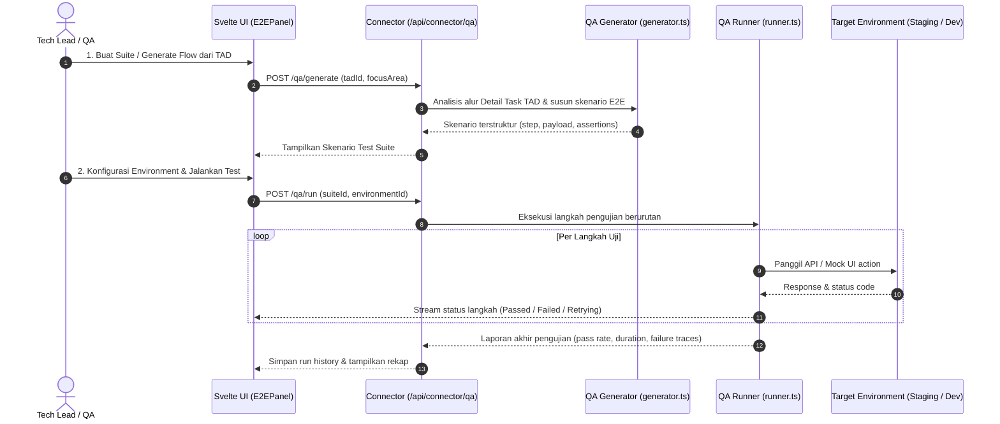

# Harness: QA Automation & E2E Test Engine

Modul ini mendokumentasikan fitur **QA Automation & E2E Testing**: generator skenario pengujian end-to-end berbasis spesifikasi TAD, manajemen environment (staging/dev), runner eksekusi otomatis, dan visualisasi hasil pengujian.

---

## 🎯 Ringkasan & Alur Kerja Fitur

QA Automation memudahkan verifikasi menyeluruh terhadap alur fitur lintas komponen:



---

## 📂 Peta File Source Code (QA Automation Module)

### Frontend (`src/projects/` & `src/lib/qa/`)
| File Path | Komponen | Deskripsi & Tanggung Jawab |
|---|---|---|
| [`src/projects/E2EPanel.svelte`](file:///Users/ridwan/mine/tech-lead-cockpit/src/projects/E2EPanel.svelte) | Panel Pengujian E2E | Antarmuka pembuatan test suite, daftar skenario uji, tombol run, dan ringkasan eksekusi test. |
| [`src/projects/E2EEnvironmentModal.svelte`](file:///Users/ridwan/mine/tech-lead-cockpit/src/projects/E2EEnvironmentModal.svelte) | Modal Manajemen Environment | Pengaturan URL base, auth token, dan mock variables untuk environment pengujian (Staging, Development, Local). |
| [`src/lib/qa/client.ts`](file:///Users/ridwan/mine/tech-lead-cockpit/src/lib/qa/client.ts) | QA API Client | Penghubung antarmuka UI dengan endpoint connector `/api/connector/qa/*`. |
| [`src/lib/qa/types.ts`](file:///Users/ridwan/mine/tech-lead-cockpit/src/lib/qa/types.ts) | Definisi Tipe Data QA | Schema untuk `QASuite`, `QAScenario`, `QAStep`, `QAEnvironment`, dan `QARunResult`. |

### Backend Connector (`connector/qa/`)
| File Path | Komponen | Deskripsi & Tanggung Jawab |
|---|---|---|
| [`connector/qa/manager.ts`](file:///Users/ridwan/mine/tech-lead-cockpit/connector/qa/manager.ts) | QA Suite Manager | Mengelola persistensi test suite, riwayat hasil pengujian, dan manajemen konfigurasi kredensial environment. |
| [`connector/qa/generator.ts`](file:///Users/ridwan/mine/tech-lead-cockpit/connector/qa/generator.ts) | AI Skenario Generator | Menganalisis dokumen arsitektur teknis untuk menghasilkan skenario pengujian realistis dengan validasi boundary & edge cases. |
| [`connector/qa/runner.ts`](file:///Users/ridwan/mine/tech-lead-cockpit/connector/qa/runner.ts) | Test Execution Engine | Mesin eksekutor HTTP requests, penegasan kondisi (*assertions*), logging error, dan penanganan timeout. |

---

## 🧭 Kelengkapan Input Generator (wajib dijaga)

Test case hanya selengkap input-nya. Tiga aturan ini mencegah journey kehilangan tahap (mis. tidak ada skenario create promo):

- **Task tidak pernah dipotong.** `POST /qa/generate` dan `POST /qa/plan` menerima maksimal `MAX_QA_TASKS` (200, `connector/qa/generator.ts`); lebih dari itu ditolak dengan pesan, bukan dipotong diam-diam. Task TAD kedua (mis. TAD CMS) biasanya ada di urutan akhir, jadi potongan selalu membuang tahap setup.
- **Codebase tidak gagal diam-diam.** `E2EPanel` membaca folder Services secara reaktif dari Pengaturan (`$derived(loadServicesRoot())`). Connector juga memakai folder di Pengaturan bila folder yang dikirim halaman tidak ada. Bila codebase tetap tidak terbaca, `prepareContext` mengembalikan `warning` dan catatan suite/rencana diawali `PERINGATAN: Codebase tidak terbaca (…)`.
- **Setup lewat API.** Prompt planner dan writer mewajibkan tahap pertama membuat data master lewat API-nya (create → approval → aktivasi), dicari di Detail Task dan router codebase (group cms/admin/backoffice). Seed hanya dipakai bila API-nya tidak ada. `uncoveredTasks` (`connector/qa/plan.ts`) menulis peringatan di catatan rencana untuk task API/integrasi/scheduler yang tidak masuk tahap mana pun. Task model, tabel, dan boilerplate hanya konteks.

---

## 🔢 Tipe variabel di request

Runner ([`connector/qa/runner.ts`](../../../connector/qa/runner.ts)) menentukan tipe JSON nilai yang isinya tepat satu variabel (`"field": "{{x}}"`):

1. **Cast eksplisit** menang: `"{{x|string}}"`, `"{{x|number}}"`, `"{{x|boolean}}"`, `"{{x|json}}"`. Di dalam teks (`"kode {{x|string}}"`) cast diabaikan.
2. **Hasil `extract`** memakai tipe aslinya dari response (`"00123"` tetap string, `77` tetap number, objek tetap objek), juga saat dibawa ke flow berikutnya (`carried.types`).
3. **Tanpa keduanya**, hanya angka aman yang dikirim sebagai number: tanpa nol di depan dan maksimal 15 digit. Nomor HP `0812…` dan nomor rekening panjang tetap string. Dulu semua string berisi angka diubah jadi number, dan `0812…` membuat step crash.

Prompt penulis, perbaikan, dan repair meminta AI menulis cast sesuai tipe di struct request.

Assertion `equals`/`contains`/`gt`/… tanpa nilai harapan gagal dengan pesan "nilai yang diharapkan belum diisi", bukan "not equal" polos. Di editor flow, string kosong ditampilkan dan ditulis sebagai `""`; kotak yang dikosongkan berarti tanpa nilai. Dulu `""` hilang saat flow diedit lalu disimpan.

---

## 🛠️ Perbaiki dengan AI (instruksi)

Tombol **Perbaiki dengan AI** di daftar skenario (atau ikon ✨ per flow) membuka panel berisi instruksi bebas, preset (tipe data sesuai struct, test yang gagal di run terakhir, nama field/path sesuai kode), cakupan (yang dicentang, hasil pencarian, atau satu flow), dan pilihan AI. `QaManager.fixFlows` (`POST /qa/fix`) menjalankan agent peran `fix` per 5 flow (maksimal 80 flow), dengan concurrency pipeline. Prompt `buildFixPrompt` ([`connector/qa/plan.ts`](../../../connector/qa/plan.ts)) berisi instruksi, JSON flow, dan ringkasan hasil run terakhir tiap flow. Agent membaca struct/router/handler (hanya baca).

`parseFix` hanya menerima flow dengan id yang dikirim. Id step dan `stage` dipertahankan, dan flow yang kembali tanpa perubahan diabaikan. Flow yang berubah diberi `repairNote` "Diperbaiki AI: …". Versi sebelumnya disimpan di `suite.undo` (satu tingkat). **Batalkan perbaikan** (`POST /qa/fix/undo`) mengembalikannya.

---

## 🧾 Membaca jawaban JSON dari AI

`extractJson` dan `repairJson` ada di [`connector/ai-json.ts`](../../../connector/ai-json.ts) (diekspor ulang oleh `connector/qa/generator.ts`) dan dipakai agent QA, bug tracing, dan estimasi. JSON yang valid dipakai apa adanya. Hanya JSON yang gagal di-parse yang diperbaiki, dan perbaikannya (variabel `{{x}}` tanpa kutip, koma di akhir) hanya menyentuh bagian **di luar string**. Dulu perbaikan berbasis regex juga mengenai teks seperti `({{a}}, {{b}}, {{c}})` di `notes`/`description`, sehingga JSON yang sebenarnya valid jadi rusak dan agent penulis gagal dengan "JSON dari AI tidak valid".

---

## 🔑 Panel "Yang perlu diatur" (variabel environment)

[`src/projects/E2ERequirements.svelte`](../../../src/projects/E2ERequirements.svelte) tampil di atas tab Skenario/Hasil Run. Panel ini menghitung, untuk flow yang dicentang dan environment terpilih, key yang masih harus diisi. Logikanya ada di fungsi murni `e2eRequirements` ([`src/lib/qa/requirements.ts`](../../../src/lib/qa/requirements.ts)) dan urutannya sama dengan runner:

| Status | Arti |
|---|---|
| `missing` | `{{nama}}` dipakai di path, header, query, body, assertion, atau `dataQueries`, tapi tidak punya nilai dari mana pun |
| `example` | Hanya ada nilai contoh AI di flow; tetap dipakai saat run, tapi jarang berupa data uji asli |
| `set` / `secret` | Ada di Variabel environment, atau di Variabel rahasia (Keychain) |
| `auto` | Di-extract dari response step/flow lain, diisi `dataQueries` (bila environment punya database), atau contohnya dibangun dari built-in (`E2E-{{$timestamp}}`) |

Built-in (`QA_BUILTIN_VARS`) tidak pernah dihitung. Panel juga menandai service tanpa base URL sendiri maupun default, dan token auth yang belum disimpan padahal ada step yang memakai auth environment. Nilai bisa diisi langsung, lalu disimpan lewat `qa.saveEnvironment`. Nama yang tampak seperti kredensial (password/pin/otp/token/secret/key) otomatis dicentang **Rahasia** sehingga masuk Keychain; variabel rahasia lama tetap dipertahankan karena dikirim sebagai nama dengan nilai kosong. **Salin daftar key** menyalin `nama = ` per baris untuk dibagikan ke QA.

---

## 🛠️ Panduan Development & Debugging

### Menjalankan Unit Test QA Engine
```bash
npm test connector/qa/qa.test.ts
```

> [!NOTE]
> Setelah melakukan perubahan pada modul QA Automation, pastikan Anda memperbarui dokumen ini jika terdapat modifikasi struktur schema skenario test atau runner API!
